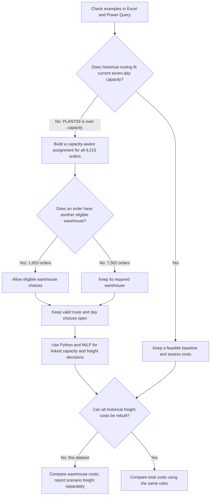
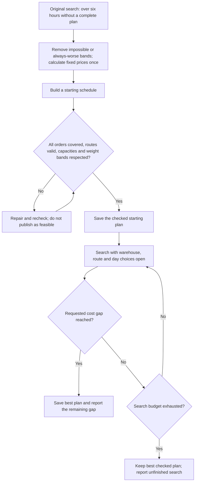

# Strategic Warehousing and Shipping

**Can the current network handle these orders, and can I find a cheaper workable assignment?** That was the question behind this project.

I used the public [Brunel dataset](https://brunel.figshare.com/articles/dataset/Supply_Chain_Logistics_Problem_Dataset/7558679), also on [Kaggle](https://www.kaggle.com/datasets/laurinbrechter/supply-chain-data). This is a portfolio case, not a client engagement.

## What I did

I checked product, customer and port restrictions in Excel and Power Query, using one product and one cost example. Python then applied the workflow to all 9,215 orders and selected warehouses, routes and processing days.

**PLANT03 was the bottleneck.** Its 8,541 historical orders exceed its current seven-day capacity of 7,091. Even after reassignment, 7,043 orders must use it, leaving just 48 slots beyond that unavoidable workload.

Only 1,653 orders have multiple warehouse choices. The others have a fixed warehouse, but their shipping day and route may still be choices.

## Result from the saved run

| Measure | Result |
|---|---:|
| Orders assigned | 9,215 |
| Historical warehouse cost | $15,633,221.91 |
| Plan warehouse cost | $15,491,530.16 |
| Warehouse-cost reduction | $141,691.76 — about 0.9% |
| Orders moved from their historical warehouse | 1,611 |
| Plan freight cost | $22,065.48 |
| Total plan cost | $15,513,595.64 |
| Remaining possible improvement under the model | $4,394.34 — 0.0283% |
| Final solver time | 3.66 seconds |

This is a checked feasible plan, not a proved exact minimum. The solver met the requested 1% gap and kept the starting plan at the same cost. Its `Optimal` status means that tolerance was met; `proven_optimal` remains `false`. Warehouse costs use the same quantity-times-rate calculation; they do not establish actual historical spending or freight savings.

## How I made the decisions

These trees show the reasoning and checks used in the project. Branches describe the decision rules; they are not all separate experiments.

### 1. Choose the problem and approach



I chose MILP because whole orders must be assigned, and one order's choices affect capacity and shared freight pricing for others. Excel established the workflow; Python applied it across the full dataset.

### 2. Find a usable plan and check the result



In this run, all 9,215 orders passed validation, no daily warehouse limit was exceeded, and the reported gap was 0.0283%. I did not permanently fix six days or sample the orders to get that result.

## Obstacles and how I handled them

| Obstacle | What I did |
|---|---|
| **No customer feedback** | Tested capacity and routing first, without claiming poor customer service. |
| **Historical demand, current limits** | Used seven days as a planning scenario, not evidence of historical delays. Unclear timing fields did not provide a verified delivery calendar. |
| **Capacity and cheap options were misleading** | Counted orders, not units. Spare slots must be at eligible plants; independently choosing each order's cheapest option ignores shared capacity. |
| **Excel became difficult to inspect** | Freight joins produced about a million rows. I loaded useful summaries, fixed the missing `Column12` step and moved automation to Python. Connection-only queries explained empty-looking sheets. |
| **Rounded order IDs broke lookups** | Kept the original decimal IDs rather than Excel's rounded display. |
| **Historical freight had gaps** | Carrier mismatches and missing weight bands prevented a full baseline. I did not force matches. Discontinued V44_3 appears on customer-arranged orders, where company freight is zero. |
| **Actual shipment groups were unknown** | Modeled compatible orders sharing a route and day. Combined weight selects a band; AIR minimum charges still apply per order. |
| **Setup and compatibility errors** | Fixed missing `pip` and a read-only-array error before trusting the run. |
| **Six hours of solving produced no plan** | Supplied a checked starting plan, removed unreachable or always-worse bands and calculated fixed prices once. Final assignments remained free to change. |
| **Grouping could add work or restrict savings** | Avoided listing every possible group or permanently fixing shipping days. A starting schedule helped without locking the answer. |
| **Other projects and runs reported different costs** | Compared scope and cost rules, then kept one run's figures together. Lower published totals were not automatically comparable. |

## Assumptions and limits

- All orders are available at the start. Processing and dispatch share an assigned day; there are no delay penalties.
- Orders stay whole. Product, customer, port, service and daily capacity rules apply.
- Warehouse cost is quantity × rate, not daily holding cost. Customer-arranged orders still incur it.
- A lower bound is not a shipping plan; the gap is possible improvement, not achieved savings.
- The 48-slot cushion is arithmetic. A PLANT03 capacity-loss test has not been completed.

Comparisons reviewed: [Dzalbs and Kalganova, 2020](https://arxiv.org/pdf/2001.08102) and [Khan, Tahsin and Mamun, 2026](https://link.springer.com/article/10.1007/s44257-026-00091-4). I have not reproduced either result or fully reconciled the original ant-colony benchmark.

## Run the analysis

Keep `supply chain analysis.py` beside `Supply chain logisitcs problem.xlsx`. Install the dependencies, then run the script using its exact filename:

```bash
python -m pip install pandas numpy openpyxl scipy highspy==1.15.1
python "supply chain analysis.py"
```

The script creates a new timestamped folder under `shipping_results` for each run. Keep that run's files together. It saves the starting plan before the final search, which has a 300-second budget and a 1% gap target. The 3.66 seconds above measures the solver, not the entire script.

## Project files

Save this document as `README.md` in the GitHub project. The file guide below covers the source workbook, Excel work, Python script and all ten result files from the uploaded run.

| File | Purpose |
|---|---|
| `README.md` | Project question, decisions, results and limitations. |
| `Supply chain logisitcs problem.xlsx` | Original seven-table dataset; retain the source values and original filename spelling. |
| `supply chain analysis.xlsx` | Excel and Power Query work used to develop and check the workflow. |
| `supply chain analysis.py` | Full analysis, eligibility checks, starting-plan construction, optimization and exports. |
| `starting_plan_orders.csv` | First checked assignment: one row per order, with warehouse, route, day and costs. |
| `starting_plan_daily_capacity.csv` | Assigned orders and remaining capacity for each warehouse and day before the final search. |
| `starting_plan_freight_groups.csv` | Initial shipping groups, combined weights, selected rate bands and freight costs. |
| `starting_plan_cost.json` | Initial warehouse, AIR, GROUND and total costs. |
| `best_plan_orders.csv` | Best checked order assignment retained after the search. |
| `best_plan_daily_capacity.csv` | Daily capacity usage for the retained plan. |
| `best_plan_freight_groups.csv` | Shipping groups and freight charges for the retained plan. |
| `best_plan_cost.json` | Cost totals for the retained plan. |
| `solve_summary.json` | Solver status, time, settings, lower bound, remaining gap and exact-optimality flag. |
| `solver.log` | Detailed search progress and solver diagnostics. |

Start with `solve_summary.json`, then inspect the three `best_plan_*.csv` files to see how the result works. Keep the `starting_plan_*` files to show what the search began with. Equal starting and final costs mean no cheaper plan was retained; the search still established a lower bound.

Use the corresponding `solve_summary.json` to update the result table. Earlier chat figures and the separate solver-benchmark package describe other runs and are not inputs to this script.

## Repository layout

The root contains the script and both workbooks. `results/validated_run/` preserves the ten outputs reported above; newly generated runs go under `shipping_results/` and are ignored by Git. `requirements.txt` lists dependencies. The Excel workbook records the original workflow; local source paths in Power Query may need updating before refresh.
